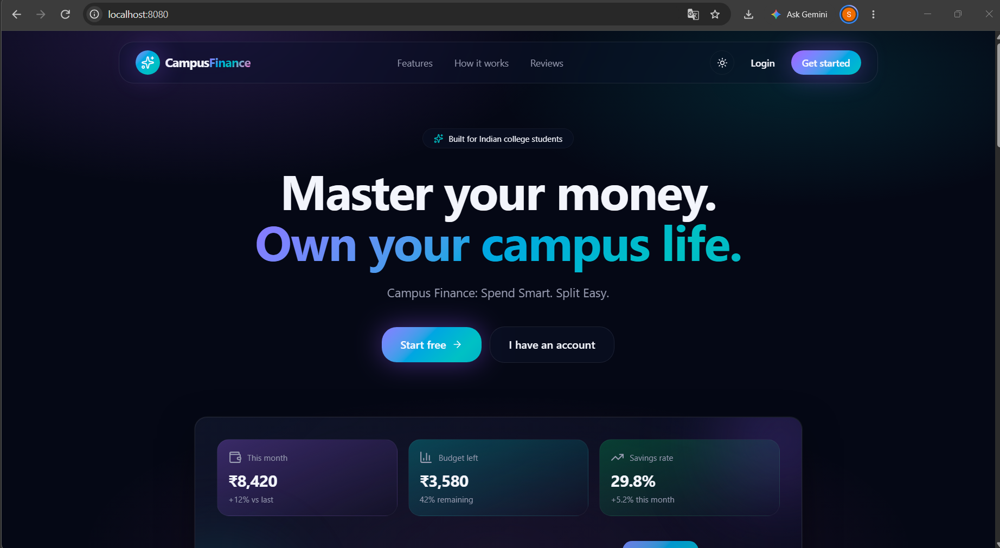
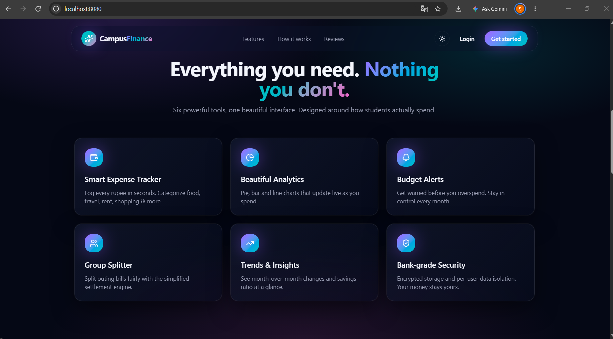
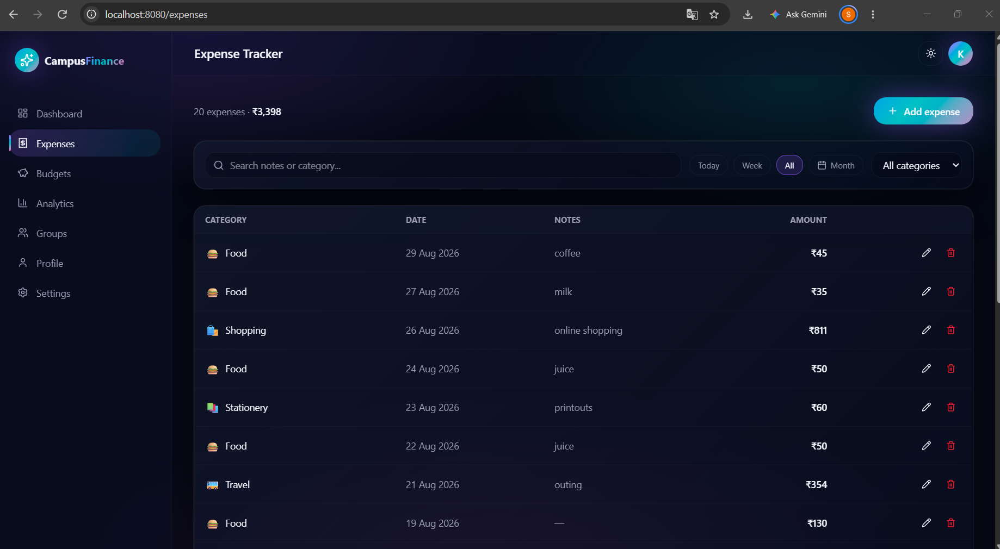
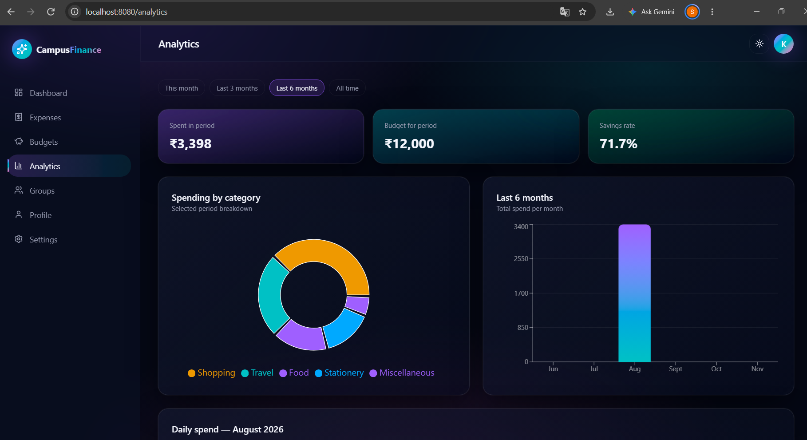
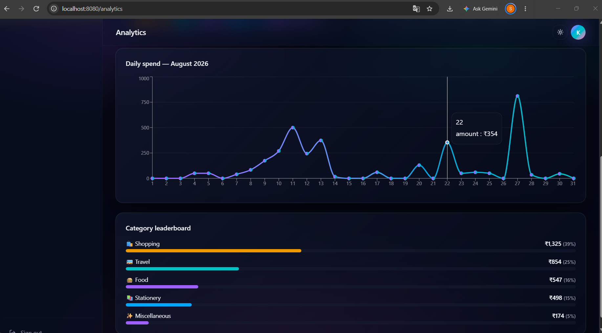
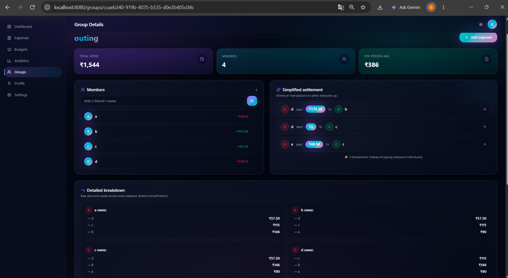
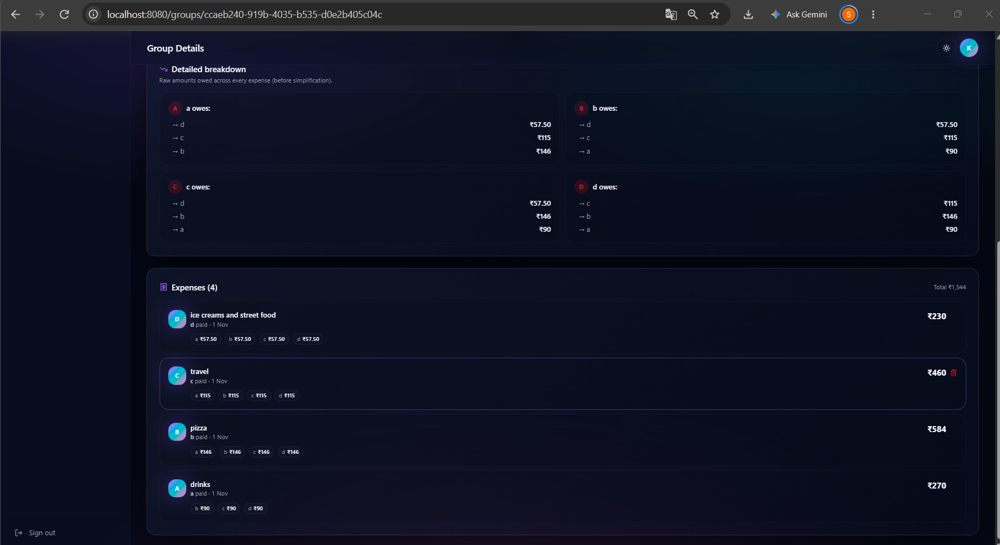

# Campus Finance Manager

A web-based personal finance management application designed to help users track expenses, manage budgets, analyse spending patterns, and split shared expenses.

## Features

- **Expense Tracking:** Add and manage daily expenses in one place.
- **Budget Management:** Set monthly budgets and monitor spending.
- **Financial Analytics:** View spending patterns and financial summaries through interactive visualisations.
- **Group Expense Splitting:** Manage shared expenses and calculate individual contributions.
- **Dashboard:** Get an overview of personal finances.

## Screenshots

### 1. Landing Page



### 2. Features



### 3. Expense Tracker



### 4. Financial Analytics

<p align="center">
  
  
</p>

### 5. Group Expense Splitting

<p align="center">
  
  
</p>

## Tech Stack

- **Frontend:** React, TypeScript, Tailwind CSS
- **UI Components:** shadcn/ui, Radix UI
- **Charts:** Recharts
- **Build Tool:** Vite
- **Backend & Database:** Supabase, PostgreSQL

## Getting Started

### Prerequisites

- Node.js
- npm

### Installation

1. Clone the repository:

   ```bash
   git clone https://github.com/sanchita-22/campus-finance26
   ```

2. Navigate to the project directory:

   ```bash
   cd campus-finance26-main
   ```

3. Install dependencies:

   ```bash
   npm install --legacy-peer-deps
   ```

4. Configure environment variables

```bash
cp .env.example .env
```

Open the `.env` file and replace the placeholders with your Supabase project credentials.

- `VITE_SUPABASE_URL` and `VITE_SUPABASE_PUBLISHABLE_KEY` are used for client-side configuration.
- `SUPABASE_URL` and `SUPABASE_PUBLISHABLE_KEY` are used for server-side configuration.
- `SUPABASE_SERVICE_ROLE_KEY` is used for server-side administrative operations. Keep this key secret and never expose it in client-side code.

Never commit your actual .env file or expose your Supabase secret keys on GitHub.

5. Start the development server:

   ```bash
   npm run dev
   ```

6. Open the local URL displayed in your terminal.

## Future Improvements

- Export expense reports.
- Add more detailed spending insights.
- Improve budget recommendations and financial summaries.

---

**Campus Finance Manager** — Making expense tracking and shared finances easier.
